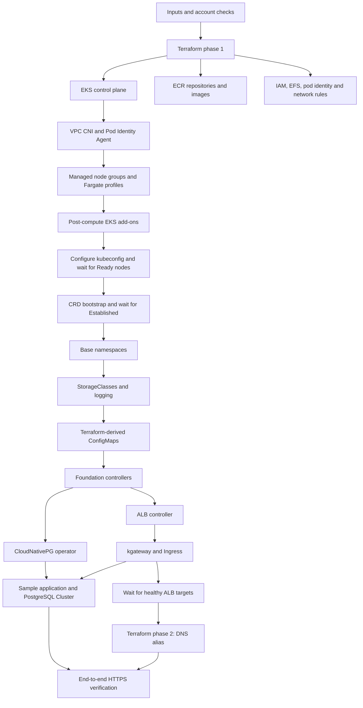

# Resource Creation Order

This document defines the required creation order for the platform. It covers
the Terraform graph, the manual Kubernetes bootstrap, the Flux dependency DAG
and the second Terraform phase that creates the custom-domain DNS record.

Creation order is important for this repository because several resources use
Kubernetes custom resource definitions (CRDs), external controllers, or
Terraform outputs that do not exist until an earlier phase is healthy.
Kustomize rendering order and YAML document order do not provide readiness
guarantees across separate API-server calls. Wait for each gate in this
document before proceeding.

## End-to-end dependency graph



The arrows represent readiness dependencies, not only object references. Some
Terraform resources and sibling Flux Kustomizations can be created in
parallel; an object that is part of a `dependsOn` relationship or a readiness
gate must not be advanced early.

## Non-negotiable rules

1. Load `.env` before Terraform, AWS, or rendering commands. The file is
   intentionally git-ignored; commit only `.env.example`.
2. Do not deploy custom-domain manifests unless the ACM certificate and domain
   variables are configured.
3. Install the VPC CNI and Pod Identity Agent before compute. Managed nodes
   cannot become Ready without VPC CNI, and controllers using Pod Identity need
   the agent on their nodes.
4. Bootstrap CRDs before any custom resource of those kinds.
5. Use server-side apply for the CRD set. Several vendored CRDs are too large
   for kubectl's client-side `last-applied-configuration` annotation.
6. Do not create an ALB Ingress before the ALB controller is ready.
7. Do not create a PostgreSQL `Cluster` before the CloudNativePG operator is
   ready.
8. Do not create a Karpenter `NodePool` or `EC2NodeClass` before the
   Karpenter controller and CRDs are ready.
9. Do not create the Route53 ALB alias while `alb_deployed` is false or before
   a healthy ALB exists.
10. When reusing a Route53 hosted zone, never replace the registrar's current
    nameservers with nameservers from another zone.
11. For the Flux path, commit and push all manifests to `main` before applying
    the Flux bootstrap. The checked-in `GitRepository` does not track `dev`
    or uncommitted changes.

## Phase 0: inputs and preflight

Run preflight checks from the repository root:

```bash
set -a
. ./.env
set +a

bin/check.sh
```

The preflight validates:

- Terraform formatting and configuration
- rendered Kustomize manifests and Kubernetes schemas
- placeholders with strict substitution
- deprecated Kubernetes API usage
- local container-image build inputs
- EKS add-on version availability when AWS credentials are available

Required account-specific inputs are:

- `AWS_PROFILE` or another valid default AWS credential chain
- `AWS_REGION`
- `TF_VAR_account_name`
- `TF_VAR_vpc_id`
- `TF_VAR_private_subnet_ids` when private subnet discovery is ambiguous
- for custom DNS: `TF_VAR_domain_name`,
  `TF_VAR_app_subdomain`, `TF_VAR_acm_certificate_arn`, and optionally
  `TF_VAR_route53_zone_id`

The chosen private subnets must:

- belong to the selected VPC
- span at least two Availability Zones
- have outbound internet access through a NAT gateway
- not be the public subnets used by the internet-facing ALB

The ACM certificate must:

- be in the same region as the ALB
- be issued
- cover the selected application hostname

## Phase 1: Terraform infrastructure

Use a saved plan:

```bash
terraform -chdir=aws/envs/eu-west-1 init
terraform -chdir=aws/envs/eu-west-1 plan -out=tfplan
terraform -chdir=aws/envs/eu-west-1 apply tfplan
```

Terraform determines the exact graph from references and `depends_on`.
The stages below are a readability and readiness model, not a requirement
that Terraform create one resource at a time.

### 1. Read and validate existing AWS resources

Terraform first reads:

- the current AWS account and region
- the selected VPC
- explicitly configured or discovered private subnets
- subnet Availability Zones
- public subnets for the ALB
- an existing Route53 zone when `TF_VAR_route53_zone_id` is set

Validation flags:

- private subnets outside the VPC
- fewer than two Availability Zones
- an incorrect or private Route53 zone
- a custom domain without a certificate ARN

These reads establish the identities used by the rest of the graph. They do
not create Kubernetes resources.

### 2. Create IAM identities and Pod Identity policies

Terraform creates:

- EKS cluster and node-group roles
- Fargate execution role
- EBS and EFS CSI IRSA roles and policies
- ALB controller Pod Identity role and policy
- Cluster Autoscaler Pod Identity role and policy
- Karpenter controller and node roles
- required managed-policy attachments

Karpenter uses an inline controller policy because the complete managed policy
can exceed IAM's 6,144-character managed-policy limit.

Role creation is independent in several branches. A Pod Identity association
waits for both the EKS cluster and its corresponding role because the
association references the cluster name and role ARN.

### 3. Create ECR repositories and build images

Each image has an ECR repository, lifecycle policy and `terraform_data`
build/push resource:

- cert-manager components
- KEDA components
- Prometheus and its supporting images
- NATS and NATS tooling
- Garage
- Cluster Autoscaler
- Karpenter
- kgateway components
- the sample application
- the sealed-secrets controller

ECR repository creation happens before its image build. The ECR login command
uses an isolated temporary Docker configuration so parallel Terraform
provisioners do not race on macOS Keychain or `config.json`. Image tags and
source hashes are the build triggers.

Image builds are independent of EKS readiness and can run in parallel with
most infrastructure creation. They must all be complete before Kubernetes
Deployments or StatefulSets reference their private ECR images.

### 4. Create storage prerequisites

Terraform creates:

- the EFS filesystem
- the EFS security group and NFS ingress rule
- one EFS mount target per selected Availability Zone

The one-target-per-AZ selection prevents EFS's uniqueness-per-AZ error when a
VPC contains multiple private subnets in the same zone.

The EBS and EFS CSI add-on role ARNs are created independently. Add-on
selection is keyed by an add-on version rather than a role ARN so the role can
be unknown during a fresh plan.

### 5. Create the EKS control plane and shared security groups

The EKS module creates:

- the cluster
- encryption configuration and KMS resources
- control-plane logging
- endpoint access configuration
- cluster and node security groups
- EKS access configuration and cluster creator administration

The cluster must be active before EKS add-ons, managed node groups, Fargate
profiles, or Pod Identity associations can be created.

Terraform also creates reciprocal rules between the EKS primary security group
used by Fargate ENIs and the managed-node security group used by EC2-backed
pods. Without both directions, Fargate workloads cannot reliably resolve
CoreDNS, reach databases or other node-hosted services, or receive traffic from
node-hosted workloads.

### 6. Install pre-compute add-ons

These add-ons use the EKS module's `before_compute` path:

1. `vpc-cni`
2. `eks-pod-identity-agent`

This split is mandatory. Installing VPC CNI in the normal post-compute path
creates a deadlock:

1. managed node groups wait for nodes to become Ready
2. nodes cannot become Ready until VPC CNI initializes networking
3. Terraform does not install post-compute add-ons until compute completes

Pod Identity Agent is also installed before compute so controller pods cannot
start on a node that lacks the identity credential endpoint.

The root configuration includes a `moved` block for VPC CNI. Upgrading an
existing state preserves the add-on while changing its Terraform address from
the normal add-on resource to the `before_compute` resource.

### 7. Create managed node groups and Fargate profiles

Only after the pre-compute add-ons are active, Terraform creates:

- the `platform` managed node group
- the `services` managed node group
- the generic Fargate profile
- the `kgateway` Fargate profile
- the `sample-app` Fargate profile

The Fargate selectors determine which workloads receive Fargate ENIs:

- all pods in the `fargate` namespace
- all pods in the `kgateway` namespace
- pods labeled `app=fastapi-app` in the `sample-app` namespace

CloudNativePG PostgreSQL pods do not match a Fargate selector and therefore
remain on managed nodes, where EBS-backed persistent volumes are attached.

### 8. Install post-compute add-ons

After managed compute is healthy, Terraform installs:

- CoreDNS
- kube-proxy
- EBS CSI driver
- EFS CSI driver

CoreDNS and kube-proxy must be healthy before application DNS and service
routing are usable. The CSI controllers must be healthy before PVCs can bind.

### 9. Create Pod Identity and Karpenter AWS resources

After the cluster and IAM roles exist, Terraform creates:

- ALB controller Pod Identity association
- Cluster Autoscaler Pod Identity association
- Karpenter Pod Identity association
- Karpenter interruption queue and EventBridge rules
- Karpenter node instance-role access entry
- discovery tags on private subnets
- Karpenter discovery tag on the node security group

The manifest ServiceAccounts do not contain account-specific role ARNs. Pod
Identity binds the configured role to the ServiceAccount at AWS level.

The Karpenter discovery tag is owned by the EKS node security group. A
`removed` block releases the former standalone `aws_ec2_tag` state without
deleting the live tag, avoiding a two-owner perpetual-diff race during
upgrade.

### 10. Create or select the Route53 zone, but not the ALB record

If custom domain is disabled, all Route53 resources are omitted.

If custom domain is enabled:

- `TF_VAR_route53_zone_id` set: Terraform reads and validates the existing
  public zone
- `TF_VAR_route53_zone_id` unset: Terraform creates a public hosted zone

The ALB alias record is deliberately omitted in phase 1 because
`alb_deployed` defaults to `false`. The ALB does not exist until the
Kubernetes ALB controller processes the kgateway Ingress.

### 11. Publish readiness outputs

Only after apply completes, Terraform exposes:

- cluster name and endpoint
- `cluster_information`
- `flux_vars`
- ECR repository URLs
- Karpenter queue and node-role values
- Route53 zone ID and nameservers
- application hostname

`bin/cluster-config.sh` is the bridge from Terraform state into Kubernetes.
Do not hand-maintain the generated ConfigMaps.

## Phase 2: Kubernetes prerequisites

Update kubeconfig and verify all managed nodes:

```bash
aws eks update-kubeconfig --region eu-west-1 \
  --name "$(terraform -chdir=aws/envs/eu-west-1 output -raw cluster_name)"
kubectl get nodes
```

Do not continue until every expected node is `Ready` and the VPC CNI and
Pod Identity Agent are running.

### 1. Bootstrap CRDs

Apply the dedicated CRD stage with server-side apply:

```bash
kubectl apply --server-side --force-conflicts \
  -k flux/envs/eu-west-1/crds/
```

This stage establishes:

- ALB controller CRDs
- Karpenter CRDs
- CloudNativePG CRDs
- Gloo Edge / kgateway CRDs
- KEDA CRDs
- Garage CRD

Wait for every CRD before creating custom resources:

```bash
kubectl wait --for=condition=Established --timeout=300s \
  $(kubectl get crd -o name)
```

The server-side flag is required by the large CloudNativePG, KEDA and other
vendored CRDs. Client-side apply can exceed the Kubernetes annotation limit.

### 2. Create base namespaces

```bash
kubectl apply -k flux/base/
```

This creates the namespaces used by:

- cert-manager
- Fargate logging
- kgateway
- CloudNativePG
- sample app
- NATS
- Garage
- generic Fargate workloads

Namespace creation is a prerequisite for every later namespaced object.

### 3. Create StorageClasses and logging configuration

```bash
kubectl apply -k flux/modules/aws-csi/
kubectl apply -k flux/modules/aws-logging/
```

`gp3` is the default dynamic provisioner. The repository also creates the
generic `efs-sc` StorageClass while leaving EFS volume use to future workload
examples; no EFS PVC is created by this deployment.

StorageClasses must exist before Prometheus, NATS, Garage, or the PostgreSQL
Cluster submits PVCs. The AWS CSI drivers themselves were installed as EKS
add-ons in Terraform phase 1.

### 4. Create Terraform-derived ConfigMaps

```bash
bin/cluster-config.sh apply
```

This creates `kube-system/cluster-information`, which is consumed by:

- Cluster Autoscaler
- Karpenter
- ALB controller

Before Flux:

```bash
bin/cluster-config.sh apply-flux
```

This creates `flux-system/cluster-vars`. Every Flux Kustomization uses strict
post-build substitution from this ConfigMap. Missing variables stop
reconciliation rather than producing empty values.

## Phase 3: ordered Kubernetes workloads

The manual path below is the canonical readiness order. Some independent
items can run in parallel after their explicit dependencies are met, but
collapsing an item with its readiness wait is unsafe.

| Order | Component | Must already be ready | Resource created | Required readiness gate |
| --- | --- | --- | --- | --- |
| 1 | cert-manager | base namespaces | webhook, CA injector, controller, RBAC | all three Deployments Available; webhook CA injected |
| 2 | Prometheus | base and `gp3` StorageClass | PVC and Deployment | Deployment Available and PVC Bound |
| 3 | NATS | base and `gp3` StorageClass | 3-node StatefulSet and stream Job | all 3 pods Ready; Job Complete |
| 4 | Garage | base, Garage CRD and `gp3` StorageClass | 3-node StatefulSet and layout Job | all 3 pods Ready; Job Complete |
| 5 | KEDA | base and KEDA CRDs | operator, metrics API server, webhooks | all 3 Deployments Available and metrics APIService Available |
| 6 | Cluster Autoscaler | base, cluster information and Pod Identity | Deployment and RBAC | Deployment Available |
| 7 | Karpenter controller | base, Karpenter CRDs, cluster information and Pod Identity | controller Deployment | Deployment Available |
| 8 | Karpenter config | Karpenter controller | `NodePool`, `EC2NodeClass`, inflate Deployment | EC2NodeClass and NodePool report Ready |
| 9 | ALB controller | ALB CRDs, cert-manager, cluster information and Pod Identity | controller, webhook TLS and IngressClass | Deployment Available and webhook certificates Ready |
| 10 | CloudNativePG operator | CNPG CRDs and namespace | operator Deployment and webhooks | operator Deployment Available |
| 11 | kgateway | CRDs, ALB controller, CloudNativePG operator and Karpenter-independent base | Gloo control plane, Gateways, VirtualServices, Service and Ingress | gloo/discovery/proxy Ready; Gloo resources Accepted |
| 12 | sample app | CNPG operator, kgateway and `gp3` StorageClass | FastAPI Deployment and PostgreSQL `Cluster` | PostgreSQL 3/3 and application Deployment Available |
| 13 | KEDA demo, optional | KEDA operator and sample app | `ScaledObject` | ScaledObject reports Ready |

### cert-manager

cert-manager's leader-election RBAC is defined for `kube-system`, while the
controllers themselves run in `cert-manager`. The environment Kustomization
must preserve the namespaces declared in the vendored resources.

```bash
bin/render.sh flux/envs/eu-west-1/cert-manager | kubectl apply -f -
kubectl -n cert-manager rollout status deployment/cert-manager
kubectl -n cert-manager rollout status deployment/cert-manager-webhook
kubectl -n cert-manager rollout status deployment/cert-manager-cainjector
```

Proceed only after the validating webhook's CA bundle is populated. Otherwise
ALB-controller `Certificate` and `Issuer` objects fail admission with an
unknown CA.

### PVC-backed workloads

Prometheus, NATS and Garage depend on the `gp3` StorageClass. Wait for their
PVCs and controllers separately:

```bash
bin/render.sh flux/modules/prometheus | kubectl apply -f -
kubectl -n kube-system rollout status deployment/prometheus

bin/render.sh flux/modules/nats | kubectl apply -f -
kubectl -n nats rollout status statefulset/nats
kubectl -n nats wait --for=condition=complete job/nats-stream-setup \
  --timeout=600s

bin/render.sh flux/modules/garage | kubectl apply -f -
kubectl -n garage rollout status statefulset/garage
kubectl -n garage wait --for=condition=complete job/garage-layout-bootstrap \
  --timeout=600s
```

The NATS one-shot Job runs with a writable `/tmp` home and working directory.
This is required by the non-root NATS CLI when it reads/writes schema cache
state.

### KEDA and autoscaling controllers

KEDA CRDs are established before the operator. Apply the module server-side so
the large `ScaledJob` CRD can update without annotation-size failures:

```bash
bin/render.sh flux/modules/keda |
  kubectl apply --server-side --force-conflicts -f -
kubectl -n kube-system rollout status deployment/keda-operator
kubectl -n kube-system rollout status \
  deployment/keda-operator-metrics-apiserver
kubectl -n kube-system rollout status deployment/keda-admission-webhooks
```

Cluster Autoscaler, Karpenter and the ALB controller use Pod Identity. Their
controllers must be able to resolve `kube-system/cluster-information` before
they can become Ready.

### ALB controller and kgateway

Apply the ALB controller before kgateway:

```bash
bin/render.sh flux/modules/aws-load-balancer-controller |
  kubectl apply --server-side --force-conflicts -f -
kubectl -n kube-system wait --for=condition=Ready \
  certificate --all --timeout=600s
kubectl -n kube-system rollout status \
  deployment/aws-load-balancer-controller
```

Then apply kgateway:

```bash
bin/render.sh flux/envs/eu-west-1/kgateway |
  kubectl apply --server-side --force-conflicts -f -
kubectl -n kgateway rollout status deployment/gloo
kubectl -n kgateway rollout status deployment/gateway-proxy
```

The Gloo Edge chart creates `gateway-proxy` and `gateway-proxy-ssl`. Do not add
another `Gateway` on port 8080. A duplicate listener causes Gloo to reject
both listeners and Envoy receives no application listener.

The Ingress health check must probe `traffic-port`, which resolves to Envoy's
registered container port 8080, rather than assuming service port 80 is the pod
port. The `/healthz` VirtualService responds directly with HTTP 200.

### CloudNativePG and the sample application

Apply the CloudNativePG operator and wait before creating the database:

```bash
bin/render.sh flux/modules/cloudnative-pg |
  kubectl apply --server-side --force-conflicts -f -
kubectl -n cnpg-system rollout status deployment/cnpg-controller-manager
```

Then apply the sample app:

```bash
bin/render.sh flux/modules/sample-app |
  kubectl apply --server-side --force-conflicts -f -
kubectl -n sample-app wait --for=condition=Ready \
  cluster/postgresql --timeout=300s
kubectl -n sample-app rollout status deployment/fastapi-deployment
```

The PostgreSQL `Cluster` creates three instances and three PVCs. The FastAPI
process resolves `postgresql-rw`; if the database or DNS is not ready, it
cannot initialize its SQLAlchemy schema. The application readiness check is
not complete until the Deployment stays Available and its database connection
is stable.

## Flux creation path

Flux automates the same dependency model after the manual prerequisites:

1. install Flux controllers
2. wait for `source-controller` and `kustomize-controller`
3. run `bin/cluster-config.sh apply-flux`
4. apply `flux/envs/eu-west-1/flux-system/`

Only the committed files reachable from the `main` branch are reconciled.

The Flux DAG is:

### Level 0: no Flux dependencies

- `crds`
- `base`

### Level 1: base storage and controllers

- `storage` depends on `base`
- `logging` depends on `base`
- `cert-manager` depends on `base`
- `cluster-autoscaler` depends on `base`
- `prometheus` depends on `base` and `storage`
- `nats` depends on `base` and `storage`

### Level 2: CRD and storage consumers

- `garage` depends on `base`, `crds` and `storage`
- `keda` depends on `base` and `crds`
- `karpenter` depends on `base` and `crds`
- `cloudnative-pg` depends on `crds`
- `aws-load-balancer-controller` depends on `cert-manager` and `crds`

### Level 3: custom resources managed by controllers

- `karpenter-config` depends on `karpenter`
- `kgateway` depends on `crds`, `aws-load-balancer-controller` and
  `cloudnative-pg`

### Level 4: application

- `sample-app` depends on `cloudnative-pg`, `kgateway` and `storage`

### Level 5: optional autoscaling example

- `keda-demo` depends on `keda` and `sample-app`

`wait: true` blocks dependent Kustomizations until the applied resources are
healthy. `karpenter-config` and `kgateway` use `wait: false` because kstatus
cannot assess all of the Gloo and Karpenter CR kinds. Their resource status
must still be checked explicitly after Flux applies them.

## Phase 4: ALB creation and target health

kgateway creates the `kgateway-alb` Ingress. The ALB controller then creates:

- an ALB
- HTTP and HTTPS listeners
- target group
- `TargetGroupBinding`
- controller-managed security-group rules
- Route53-compatible DNS name

Wait for:

```bash
kubectl -n kgateway get ingress kgateway-alb
kubectl -n kgateway get targetgroupbinding
```

The Ingress address must be populated. Confirm AWS target health:

```bash
TG_ARN="$(
  kubectl -n kgateway get targetgroupbinding \
    -o jsonpath='{.items[0].spec.targetGroupARN}'
)"
aws elbv2 describe-target-health --target-group-arn "$TG_ARN"
```

Every target must be `healthy`. A target on port 8080 proves that the registered
gateway endpoint matches Envoy's listener port. A `502` from the ALB is not a
DNS problem; inspect target health, Gloo listener acceptance, Envoy xDS and
upstream discovery.

## Phase 5: Terraform DNS phase

Only after the ALB exists and has healthy targets:

```bash
terraform -chdir=aws/envs/eu-west-1 plan \
  -var="alb_deployed=true" \
  -out=tfplan
terraform -chdir=aws/envs/eu-west-1 apply tfplan
```

This phase creates one alias `A` record for:

```text
<app_subdomain>.<domain_name> -> ALB
```

The ALB data lookup matches both:

- `elbv2.k8s.aws/cluster`
- `ingress.k8s.aws/stack=<ENV_PREFIX>-ingress`

If an existing hosted zone is configured, Terraform creates only the alias
record and preserves every other record in that zone. Its nameservers must
already be delegated by the domain registrar.

If Terraform created the hosted zone, update the registrar to use:

```bash
terraform -chdir=aws/envs/eu-west-1 output route53_nameservers
```

Do not perform this nameserver change when `TF_VAR_route53_zone_id` refers to
an already delegated zone.

## Final acceptance gates

The deployment is complete only after all of these checks pass:

```bash
# Infrastructure drift
terraform -chdir=aws/envs/eu-west-1 plan \
  -var="alb_deployed=true" \
  -detailed-exitcode

# Cluster health
kubectl get nodes
kubectl -n sample-app get cluster postgresql
kubectl get nodepool,ec2nodeclass.karpenter.k8s.aws

# Required jobs
kubectl -n nats wait --for=condition=complete \
  job/nats-stream-setup --timeout=60s
kubectl -n garage wait --for=condition=complete \
  job/garage-layout-bootstrap --timeout=60s

# DNS and HTTPS
curl "https://$(terraform -chdir=aws/envs/eu-west-1 \
  output -raw app_hostname)/"
```

Expected state:

- no node is `NotReady`
- no active workload pod is Pending, CrashLooping or unready
- all three PostgreSQL instances are Ready
- ALB targets are healthy on port 8080
- `books.<domain>` resolves to the ALB
- HTTP redirects to HTTPS
- HTTPS returns the sample app with valid certificate verification

## Failure boundaries and safe retries

### Terraform fails during the initial apply

Do not recreate resources manually. Diagnose the failed resource, preserve the
local state, fix the configuration, run a fresh plan and apply the new plan.
For an AWS object created before Terraform recorded it in state, import that
exact object rather than allowing Terraform to create a duplicate.

### A Kubernetes apply reports `no matches for kind`

The relevant CRD was not established. Re-run the server-side CRD bootstrap,
wait for `Established`, then reapply the affected Kustomization.

### A CRD apply reports annotation size overflow

Do not retry with client-side apply. Use:

```bash
kubectl apply --server-side --force-conflicts
```

### cert-manager webhook rejects resources with an unknown CA

Do not delete the webhook configuration as a workaround. Verify:

- cert-manager Deployments are Available
- leader-election Roles are in `kube-system`
- the webhook Service resolves
- the CA bundle is populated
- webhook certificates are valid

### Fargate DNS or cross-namespace service discovery fails

Verify CoreDNS is healthy and verify reciprocal node/Fargate security-group
rules. A DNS error from both the gateway and database consumers usually
indicates a shared network path, not two independent application failures.

Restart only workloads that cached DNS/xDS failures after correcting the
network path.

### ALB targets are unhealthy

Check in order:

1. target IP and port
2. health-check port is `traffic-port`
3. Envoy listeners 8080 and 8443 exist
4. Gloo Gateways are Accepted
5. VirtualServices are Accepted
6. health-check path `/healthz` is routed
7. security-group ingress permits the ALB SG to the target port

### Public DNS does not resolve

First query the Terraform-selected Route53 zone directly. If that zone answers,
inspect the registrar's nameservers. The application, ALB and Route53 records
may all be healthy while the parent delegation still points elsewhere.

## Deletion must preserve the reverse dependency order

Creation order and teardown order are intentionally related:

1. suspend/remove Flux without pruning workloads
2. delete the Ingress while the ALB controller is still running
3. delete Karpenter configuration while Karpenter is still running
4. delete KEDA custom resources while KEDA is still running
5. delete the CloudNativePG `Cluster` while the CNPG operator is still running
6. wait for PVC and PV deletion
7. remove operators, controllers, namespaces and CRDs
8. destroy Terraform with `alb_deployed` left false

Do not use one aggregate deletion as a substitute for the controller-owned
cleanup stages. See the Teardown section in the README for commands.

## Source-of-truth files

| Concern | Source |
| --- | --- |
| Environment inputs | `.env.example` and local `.env` |
| Terraform root graph | `aws/envs/eu-west-1/*.tf` |
| EKS add-on ordering | `aws/modules/eks-cluster/main.tf` |
| ECR image build | `aws/modules/ecr/main.tf` |
| Kustomize CRD bootstrap | `flux/envs/eu-west-1/crds/kustomization.yaml` |
| Flux dependency DAG | `flux/envs/eu-west-1/flux-system/kustomizations.yaml` |
| Terraform-to-Kubernetes values | `bin/cluster-config.sh` |
| Manual Flux-equivalent rendering | `bin/render.sh` |
| Validation gate | `bin/check.sh` |
| Operational commands | `README.md` |

If this document and the implementation disagree, treat the disagreement as a
deployment defect. Update the code, this document and the README together.
